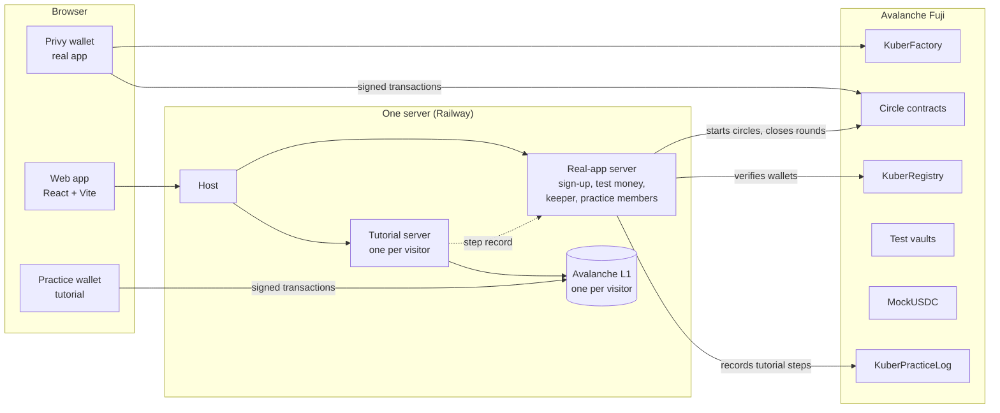
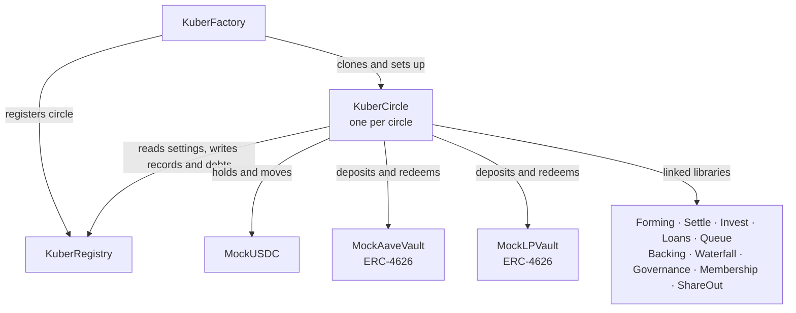

# Kuber

**Save your money together.** A savings circle on Avalanche where the rules hold the money, not a person.

A small group saves the same amount each round. The pooled money is put to work. Members can borrow against their own savings, or borrow more when friends back them. If a borrower stops paying, their own savings pay first, then only the members who backed them. **If you backed nobody, nobody else's default can touch your savings.**

- **Live demo:** <https://kuber-production.up.railway.app>
- **Network:** Avalanche Fuji testnet (C-Chain, chain id 43113), plus Kuber's own Avalanche L1, Quiet Pine (chain id 524941)
- **Built by:** Subham Mandal

## It is on-chain: check it yourself

Every contract below is deployed on Avalanche Fuji and its source is verified. Open any link to read the code and see the transactions.

### Main contracts

| Contract | What it is | Address on Fuji |
|---|---|---|
| KuberFactory | Creates circles | [`0xcD0a42d583FfC8828Dd1AF763fe8f296CC80e2aB`](https://testnet.snowtrace.io/address/0xcD0a42d583FfC8828Dd1AF763fe8f296CC80e2aB) |
| KuberCircle | The circle logic every circle copies | [`0x76bC1C04dbd2e92aCc94E30dACf1a787B3431B25`](https://testnet.snowtrace.io/address/0x76bC1C04dbd2e92aCc94E30dACf1a787B3431B25) |
| KuberRegistry | Who is verified, each person's record, debts that follow a person, settings | [`0x42B7952635687C695036BAe1de7f67c2E7eC00B0`](https://testnet.snowtrace.io/address/0x42B7952635687C695036BAe1de7f67c2E7eC00B0) |
| MockUSDC | Test money (mUSDC, 6 decimals) | [`0x2d2345237E7B49b252b4be208E91366A6EF08105`](https://testnet.snowtrace.io/address/0x2d2345237E7B49b252b4be208E91366A6EF08105) |
| MockAaveVault | Test vault standing in for Aave (ERC-4626) | [`0x73F22060975713baEfB0fF11120de7e9c4236849`](https://testnet.snowtrace.io/address/0x73F22060975713baEfB0fF11120de7e9c4236849) |
| MockLPVault | Test vault standing in for a liquidity pool (ERC-4626) | [`0xe7AcB6DB6BD00126981762d69dF65BE4B64C2be9`](https://testnet.snowtrace.io/address/0xe7AcB6DB6BD00126981762d69dF65BE4B64C2be9) |
| KuberPracticeLog | Public record of tutorial steps | [`0xf5E84885fCF15FCb108817B3611dDEb3f0DfC774`](https://testnet.snowtrace.io/address/0xf5E84885fCF15FCb108817B3611dDEb3f0DfC774) |

### Libraries linked into KuberCircle

| Library | What it does | Address on Fuji |
|---|---|---|
| Forming | Invites, joining, starting or cancelling a circle | [`0xb3015677D08e5Cd538B0f37d553bbae32fd011E5`](https://testnet.snowtrace.io/address/0xb3015677D08e5Cd538B0f37d553bbae32fd011E5) |
| Settle | Closes a round: collects savings and repayments, in batches | [`0x7362974b938AA9cAc072C29FB336ed6aa724a208`](https://testnet.snowtrace.io/address/0x7362974b938AA9cAc072C29FB336ed6aa724a208) |
| Invest | Values the pot and moves money between cash, loans and the two vaults | [`0x76116697ceDa773fd0E62B3fd0ACefEEa3800cE2`](https://testnet.snowtrace.io/address/0x76116697ceDa773fd0E62B3fd0ACefEEa3800cE2) |
| Loans | Loan requests, terms, repayments, fines | [`0xC4DEBEd5fceCac772A4B1C620361fAE1c09f2d51`](https://testnet.snowtrace.io/address/0xC4DEBEd5fceCac772A4B1C620361fAE1c09f2d51) |
| Queue | Which loan requests get funded, in a fair order | [`0x806d64356e0346Df90daD5269d2D82a18b85214a`](https://testnet.snowtrace.io/address/0x806d64356e0346Df90daD5269d2D82a18b85214a) |
| Backing | Members backing a loan (vouch or agree), pledges and their interest | [`0x1c2c2bfc87581cFb6a99ef9844Fc05Cb18a48ed0`](https://testnet.snowtrace.io/address/0x1c2c2bfc87581cFb6a99ef9844Fc05Cb18a48ed0) |
| Waterfall | Who pays when a borrower stops paying | [`0x7ee4dB5eF9b311691369eff83D949cb616191D95`](https://testnet.snowtrace.io/address/0x7ee4dB5eF9b311691369eff83D949cb616191D95) |
| Governance | Proposals, votes, applying changes | [`0xec68B035cAd7ab0848711D5E924706742BF411b3`](https://testnet.snowtrace.io/address/0xec68B035cAd7ab0848711D5E924706742BF411b3) |
| Membership | Leaving, removal, joining mid-cycle, exit value | [`0x1aF3D26F944da8101424E0273315c36102ff6830`](https://testnet.snowtrace.io/address/0x1aF3D26F944da8101424E0273315c36102ff6830) |
| ShareOut | The final payout when the circle ends | [`0x9c72e789c2Dd19aA9885b6C48d13E45C3096C54D`](https://testnet.snowtrace.io/address/0x9c72e789c2Dd19aA9885b6C48d13E45C3096C54D) |

Deployed at block 61,038,808. The same addresses are in [`deployments/fuji.json`](deployments/fuji.json).

### Kuber's own Avalanche L1: Quiet Pine

Kuber has its own Avalanche L1 on the Fuji testnet, created on 2026-11-14.

| | |
|---|---|
| Name | Quiet Pine |
| EVM chain id | `524941` |
| Blockchain id | `21hNosZu1zWB5VVjnLwAFJNM8muqsGYHPVaDoWfz8VDmVvLd5C` |
| RPC URL | `https://managed-nodes.avax.network/ext/bc/21hNosZu1zWB5VVjnLwAFJNM8muqsGYHPVaDoWfz8VDmVvLd5C/rpc` |
| Gas token | QUIET |
| Validator manager (on Fuji C-Chain) | [`0xc7450e9ad4847162f92b1b8d7fe03191b5f2ebd2`](https://testnet.snowtrace.io/address/0xc7450e9ad4847162f92b1b8d7fe03191b5f2ebd2) |

To add it to a wallet, use the chain id and RPC URL above.

**What runs where today:** the Kuber contracts and the real app run on the Fuji C-Chain (addresses above). The tutorial's practice circles run on a private practice chain and record every step on the Fuji C-Chain. Quiet Pine is live and is the planned home for the practice circles; the Kuber contracts are not deployed on it yet.

### How to check a transaction

- **In the real app:** every action (create, join, save, borrow, back, repay, vote, collect) is a transaction from your own wallet on Fuji. The result line shows its hash; tap it for the details, then "View on Snowtrace".
- **In the tutorial:** the practice circle runs on an Avalanche L1 so rounds can be skipped, and the app shows each transaction's details. Every step is also recorded by a real transaction on Fuji in `KuberPracticeLog`, and the app links to it on Snowtrace.
- **Every circle is its own contract.** The circle page shows its address under "On the chain" with a Snowtrace link. The first circle created on Fuji is [`0x19abd310E071F6Bc8f650d11a9ec427A7F03A7Ca`](https://testnet.snowtrace.io/address/0x19abd310E071F6Bc8f650d11a9ec427A7F03A7Ca).

## Architecture

### The whole system



### The contracts



- **One contract per circle.** `KuberFactory.createCircle` makes a small copy (an EIP-1167 clone) of the `KuberCircle` logic and sets it up with the circle's rules. A circle holds its own money; no person and no shared pool can move it.
- **Logic is split into ten linked libraries** so the circle contract stays under the size limit (19,399 bytes of 24,576). They all work on the circle's own storage.
- **The registry is the only shared state:** who is verified, each person's track record, how many circles they are in (at most 5), and debts. A person with an unpaid debt cannot create or join a circle.
- **Money leaves a circle only by claim.** Payouts, loans and fees are credited and then collected by the person they belong to.

### A round, step by step

A circle runs for a fixed number of rounds. Each round has an open window for actions and a short locked window before it closes.

1. **Collect.** Each member's saving for the round is taken (if they have not paid it already), together with any loan repayment due. A missed payment is recorded and fined.
2. **Vote count.** Proposals from this round are counted and passed ones are applied: rules, the money plan, the fund manager, leaving.
3. **Fund loans.** Requests are funded in a fair order from the part of the pot kept ready to lend.
4. **Put the rest to work.** The pot is rebalanced between cash, the lending part and the two vaults, following the money plan.
5. **Last round only: share-out.** Vaults are emptied, earnings are shared by how much and how long each member saved, and everyone can collect.

Closing a round is done in batches of members, so it works for circles of 50. Anyone may send it; the server's keeper does.

### When a borrower stops paying

1. The borrower's own savings pay first.
2. Then the members who **vouched**, in proportion to what they pledged.
3. Then the members who **agreed** (a lighter kind of backing that earns half).
4. Members who backed nobody lose nothing to that default. The contract tests assert this is exactly 0.
5. What is still owed stays with the borrower as a debt in the registry.

### Fund manager and money plan

The circle can vote one member in as fund manager. The manager proposes how the pot is split (ready to lend, Aave, LP pool, cash); every change is still a vote. A manager's fee applies only to positive earnings and is itself set by vote.

## The app

### Tutorial mode
New accounts play it once. It is a real practice circle of six: you and five practice members (Bala, Chitra, Dev, Esha, Farhan). You choose to join Bala's circle or create your own.

| Chapter | What you do | What you see |
|---|---|---|
| 1. Join and save | Join or create; rounds close | Everyone saves 100 a round; the pot is put to work |
| 2. Borrow | Ask for 350 | 270 against your own savings, 80 backed by Bala. "Bala could lose up to 80.00 · Bala earns 6.40" |
| 3. Repay | Two payments | Bala earns 6.40 for backing you |
| 4. Vote | Vote Bala in as fund manager; vote on a rule | Each passes with more than half of the members |
| 5. A member stops paying | Watch | Dev's own savings pay 300 first; his backers Chitra and Esha lose 30 and 20; Farhan and you lose nothing |
| 6. Share-out | Collect | You get 712.04 back from 700 saved |

These numbers are the worked example in `docs/SPEC.md` §4. The contract tests and the server's end-to-end test check them to the last unit. Afterwards a "Tutorial mode" switch lets you replay any chapter with test money.

### Real app (Fuji)
Sign in with Privy and you get a wallet, 20,000 test mUSDC and a little AVAX for gas. Then: create a circle, invite people by name, join, save, borrow, back a friend's loan with the risk shown in money, repay, vote, vote in a fund manager, change the money plan, leave, collect. Rounds run in real time (pick 2-minute rounds to try it quickly). If you are alone, add practice members to fill the circle.

## Run it yourself

You need [Foundry](https://getfoundry.sh) 1.9, Node 26 and pnpm 12.

```sh
git clone --recurse-submodules https://github.com/SubhoDevacc/kuber.git
cd kuber
pnpm install
pnpm dev
```

Then open <http://localhost:5173>. This starts a local chain with the real contracts, the tutorial server and the web app. The real app on Fuji needs server keys, so locally you get the tutorial; use the live demo for the real app.

## Tests

```sh
cd contracts && forge test        # contract tests
pnpm -r test                      # contracts + shared + server end-to-end + web
pnpm lint && pnpm check:versions
```

- Contract tests: unit tests, the SPEC §4 worked example to the unit, property tests, and a stateful invariant suite across two circles that share members. Eight planted bugs are each caught by a named check. Slither reports no high or medium finding.
- Server tests play the whole tutorial as a user (both starting paths), run two users at once through the hosted process, and run the real app end to end on a local stand-in for Fuji.

## Layout

| Path | What |
|---|---|
| `contracts/` | Solidity (Foundry): contracts, deploy scripts, tests |
| `deployments/fuji.json` | Addresses on Fuji |
| `packages/shared/` | Contract ABIs for the server and the app |
| `services/dev-api/` | Server: tutorial engine, real-app server, keeper, host |
| `apps/web/` | The web app (React, Vite, Tailwind) |
| `scripts/` | One-command start, deploy, verify |
| `Dockerfile` | The hosted demo |
| `docs/` | Product, spec, pages, test plan, demo wording |
| `STATUS.md` | What is done, what is mocked for the demo, what is left |

## Honest limits

This is a proof of concept on a test network with test money. The token and the two vaults are mocks, the identity check is mocked, practice members are run by the server, and the tutorial's logic runs on an Avalanche L1 with each step recorded on Fuji. [`STATUS.md`](STATUS.md) lists every shortcut and what a real version needs.
